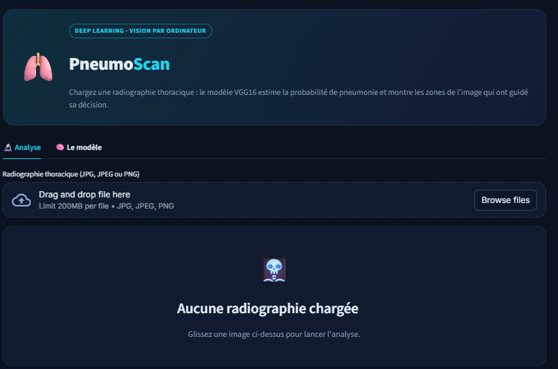

# 🫁 PneumoScan – Détection de pneumonie par Deep Learning

Projet académique – **Yousra Erraki** · EMSI Rabat (IA & Data Science)

Application Streamlit qui analyse une **radiographie thoracique** et estime la probabilité de pneumonie à l'aide d'un modèle **VGG16** (Transfer Learning + Fine-Tuning + Data Augmentation), avec une carte **Grad-CAM** qui montre les zones ayant guidé la décision.

## Résultats (jeu de test, 624 images)

| Accuracy | Rappel pneumonie | Précision pneumonie | Rappel normal |
|---|---|---|---|
| 93 % | 98 % | 91 % | 84 % |

## Lancer l'application

```bash
pip install -r requirements.txt
streamlit run app.py
```

Placer le modèle entraîné `modelVGG16_FineTuning.h5` dans le même dossier que `app.py`.

Données : [Chest X-Ray Images (Pneumonia) – Kaggle](https://www.kaggle.com/datasets/paultimothymooney/chest-xray-pneumonia)

> ⚕️ Projet académique : cet outil ne remplace pas l'avis d'un médecin.

## Aperçu




**Résultats sur 624 radiographies de test (seuil 50 %) :** accuracy 75,8 %, rappel pneumonie 99,7 %, spécificité 35,9 %. Le modèle détecte presque toutes les pneumonies mais génère des fausses alertes sur les poumons sains : le seuil de décision permet d ajuster ce compromis.
