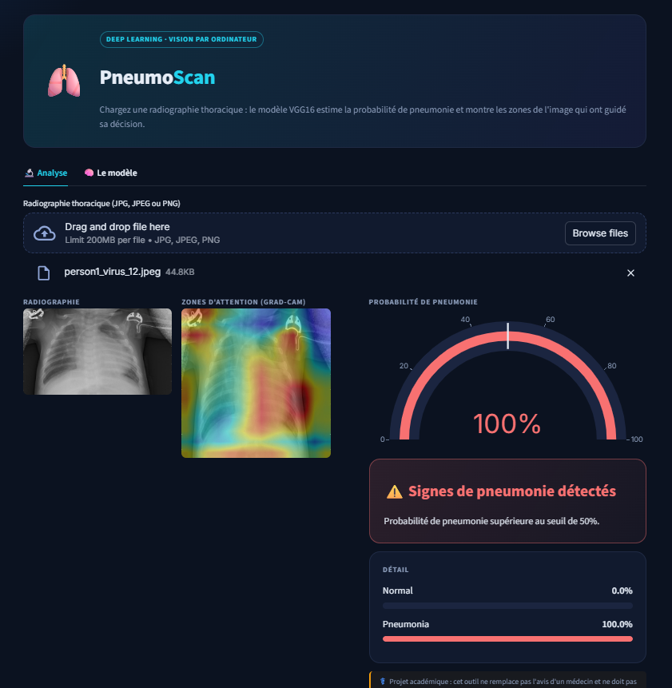
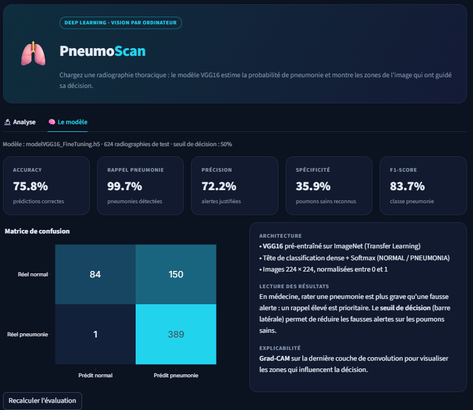

# 🫁 PneumoScan – Détection de pneumonie par Deep Learning

Projet académique – **Yousra Erraki** · EMSI Rabat (IA & Data Science)

Application Streamlit qui analyse une **radiographie thoracique** et estime la probabilité de pneumonie avec un modèle **VGG16** (Transfer Learning), entraîné sur le dataset Kaggle [Chest X-Ray Images (Pneumonia)](https://www.kaggle.com/datasets/paultimothymooney/chest-xray-pneumonia).



## ✨ Fonctionnalités

- **Analyse** : probabilité de pneumonie, verdict et carte **Grad-CAM** (zones de l'image qui ont guidé la décision)
- **Seuil de décision réglable** : compromis entre pneumonies détectées et fausses alertes
- **Évaluation** : accuracy, rappel, précision, spécificité, F1 et matrice de confusion calculés sur le dossier de test du dataset

## 📊 Résultats (624 radiographies de test, seuil 50 %)

| Accuracy | Rappel pneumonie | Précision | Spécificité | F1-score |
|---|---|---|---|---|
| 75,8 % | 99,7 % | 72,2 % | 35,9 % | 83,7 % |

Le modèle détecte presque toutes les pneumonies (389 sur 390), mais génère des fausses alertes sur les poumons sains (150 sur 234). En médecine, rater une pneumonie est plus grave qu'une fausse alerte ; le **seuil de décision** permet d'ajuster ce compromis.



## 🚀 Lancer l'application

```bash
pip install -r requirements.txt
streamlit run app.py
```

Placer le modèle entraîné (`.h5`) dans le même dossier que `app.py`. Pour l'évaluation, indiquer le chemin du dossier `chest_xray/test` dans l'onglet « Le modèle ».

## 🔭 Pistes d'amélioration

- Fine-tuning des dernières couches de VGG16 et data augmentation
- Pondération des classes pour réduire les fausses alertes
- Choix du seuil optimal sur un jeu de validation plus grand

## 🛠️ Technologies

Python · TensorFlow/Keras · VGG16 · OpenCV · Streamlit · Plotly

> ⚕️ Projet académique : cet outil ne remplace pas l'avis d'un médecin.
